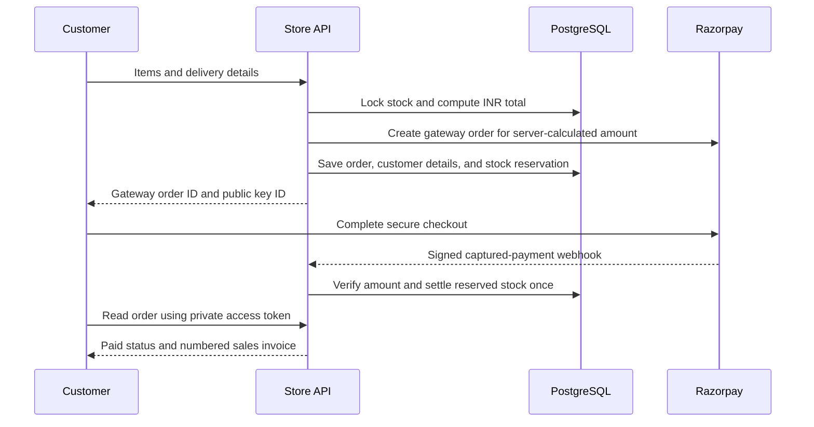
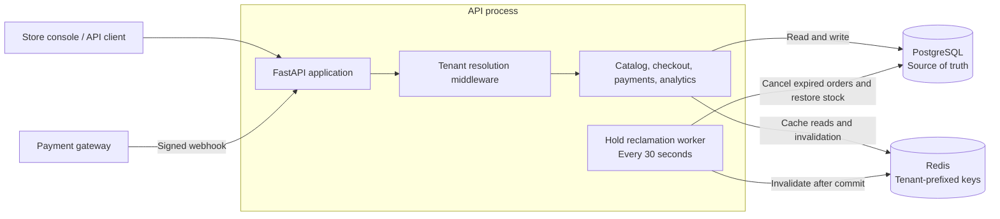
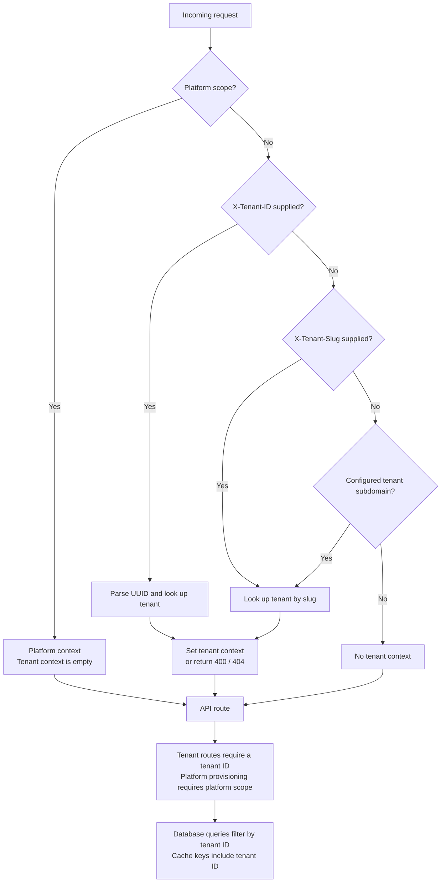
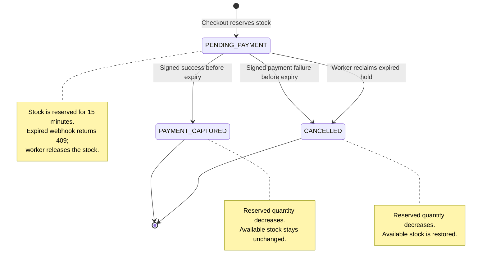
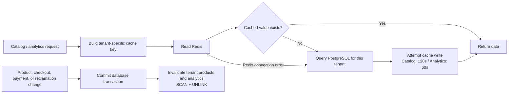

# Architecture Wiki

## The website at a glance

The main product is now one online store, with a public storefront and a
password-protected admin area. Both are served by FastAPI. PostgreSQL stores
products, inventory, orders, delivery details, and payment references.

```mermaid
flowchart LR
    Customer["Customer"] --> Shop["Storefront<br/>Browse, bag, checkout, order status"]
    Owner["Store owner"] --> Admin["Admin area<br/>Products, stock, orders, delivery"]
    Shop --> API["FastAPI<br/>Single-store API"]
    Admin -->|Signed login cookie| API
    API --> DB[("PostgreSQL")]
    API -->|Create order and verify capture| Gateway["Razorpay"]
    Shop -->|Secure payment form| Gateway
    Gateway -->|Signed webhook| API
    Worker["Expiration worker"] -->|Restore unpaid stock| DB
```

The browser always uses the site's own API. Customers do not enter tenant IDs
or API base URLs. The configured store is an internal tenant in the retained
inventory engine. `STOREFRONT_MODE=true` hides the older demo endpoints.



The checkout callback also verifies the payment signature and fetches the
captured payment from Razorpay. Webhooks cover cases where the customer closes
the browser. Repeated callbacks/webhooks do not settle stock twice.

`shop_products` adds product image URLs. `shop_orders` adds customer/seller
snapshots, private order-token hashes, gateway references, shipping fees, and
fulfilment status. The public catalog reads PostgreSQL directly. Redis remains
available to the older engine and for its namespace invalidation.

The business is not GST-registered. After verified capture, a locked counter
assigns an invoice number per store and Indian financial year. The downloadable
document is a sales invoice with no GST charged, not a GST tax invoice.
International delivery rates and merchant payment activation must be configured.
See [LAUNCH.md](LAUNCH.md) for the current launch gaps and deployment steps.

## Inventory engine reference

The following diagrams describe the existing engine that provides stock holds,
tenant isolation, payment state transitions, and optional cached analytics.

Start with the service map, then follow a request through tenant resolution,
checkout, and the order lifecycle. These Mermaid diagrams render directly on
GitHub and in Markdown viewers with Mermaid support.

## Service boundaries

FastAPI exposes the tenant-scoped catalog, checkout, payment webhook, and store
analytics endpoints. PostgreSQL is the system of record. Redis is an isolated,
tenant-prefixed cache. A separately scheduled coroutine reclaims expired
inventory holds every 30 seconds. The initial implementation starts that worker
with the API; production deployments should run one dedicated worker process or
use a distributed scheduler/lease when running multiple API replicas.



The worker runs inside the API process by default. Both use the same database
and cache; the gateway supplies signed events to the payment endpoint.

## Tenant identity and isolation

The HTTP middleware resolves requests in this order: platform scope, tenant ID,
tenant slug, then the configured platform-domain subdomain. It looks up and
validates tenant identities and sets `current_tenant_id`, `current_tenant_slug`,
and `is_platform_scope` context variables for the request lifetime. Tokens are
reset in `finally`, so reused async tasks cannot inherit stale tenant context.
All catalog, inventory, order, order-item, and payment-event data is constrained
by tenant ID. Tenant-scoped uniqueness and composite foreign keys prevent
cross-tenant references.

`X-Role` is an integration/demo RBAC claim, not an authentication mechanism.
Production deployments must derive roles and tenant access from verified
credentials and must not trust a caller-provided role header.



Tenant resolution determines the request's scope. Authentication must establish
which scope a caller is allowed to use in a production deployment.

## Checkout and inventory consistency

Checkout coalesces repeated product lines, sorts product UUIDs, and locks
inventory rows one at a time in that deterministic order using `FOR UPDATE`.
Availability checks and reservation updates occur in one transaction. A
conflict rolls back all writes; a successful reservation has a 15-minute
payment deadline. Inventory and order state mutations invalidate product and
analytics cache namespaces after commit.

```mermaid
sequenceDiagram
    participant Client
    participant API as Checkout API
    participant DB as PostgreSQL
    participant Cache as Redis
    Client->>API: POST /checkout with tenant scope and items
    API->>API: Combine repeated products and sort UUIDs
    API->>DB: BEGIN; load active products for tenant
    API->>DB: Lock inventory rows in UUID order
    alt Missing product, insufficient stock, or total overflow
        API->>DB: ROLLBACK
        API-->>Client: 404, 409, or 422
    else Reservation can be created
        API->>DB: Create pending order and order items
        API->>DB: Move quantity from available to reserved
        API->>DB: COMMIT with 15-minute payment deadline
        API->>Cache: Invalidate tenant catalog and analytics
        API-->>Client: 201 with order ID, total, and deadline
    end
```

The locks keep simultaneous checkouts from reserving the same stock. A failure
rolls back the entire reservation, including orders with several products.

## Payment event handling

Webhook bodies are authenticated with HMAC-SHA256 and constant-time comparison.
Payment event IDs have a global unique constraint. Event recording, order
transition, and inventory settlement/restoration share one database
transaction. Duplicate delivery is checked again after acquiring the order
lock, and exits without applying side effects. Event IDs reused for another
tenant or order are rejected. Expired holds cannot capture a payment, even
before the reclamation worker runs. The gateway signature secret must be
injected from a secrets manager in production.



Invalid signatures return `401`; malformed or unsupported events return `400`.
A duplicate event for the same tenant and order returns `duplicate_ignored`
without another stock update. Reusing an event ID for a different tenant or
order returns `409`.

## Cache design

Keys follow `tenant:{tenant_id}:{namespace}:{key_suffix}`. Catalog entries are
cached for 120 seconds and analytics for 60 seconds. Namespace invalidation
iterates Redis `SCAN` and removes keys asynchronously with `UNLINK`, avoiding a
blocking `KEYS` operation. Catalog responses report `X-Cache: HIT` or `MISS`.
Category filters have distinct keys, including the literal category `all` and
an empty category. Redis connection errors fall back to database reads and
do not fail already committed mutations; failed invalidation may leave old
cache entries visible until their TTL expires.



The database remains authoritative. Cache failures allow requests to continue;
cache invalidation runs after the database transaction succeeds.

## Analytics semantics

Gross revenue is the value of all non-cancelled orders, including orders still
awaiting payment. Captured revenue includes only `PAYMENT_CAPTURED` orders.
Average order value is captured revenue divided by captured orders. Conversion
rate is captured orders divided by non-cancelled orders. Top-selling SKU totals
include captured orders only and are grouped by tenant and SKU.

## Database lifecycle and deployment

`AUTO_CREATE_SCHEMA=true` is convenient for local development. Production
should disable it and apply reviewed, versioned database migrations before
deploying application code. PostgreSQL and Redis healthchecks are included in
the Compose and CI definitions. The API image runs as UID/GID 1001 and exposes a
health endpoint.

## Operational considerations

- Configure TLS at the ingress and restrict platform-scope access.
- Add authentication, rate limits, webhook replay windows, and audit records.
- Monitor database pool saturation, lock waits, worker backlog, Redis latency,
  and webhook failures.
- The API-side worker is suitable for a single instance. For horizontally
  scaled production, deploy a singleton/leased worker and retain row locking
  with `SKIP LOCKED`.
- Automated tests require PostgreSQL 16-compatible and Redis 7 services.
